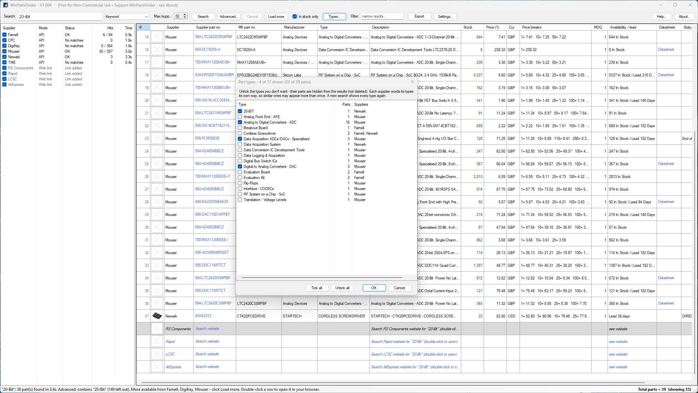
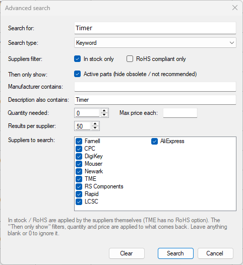
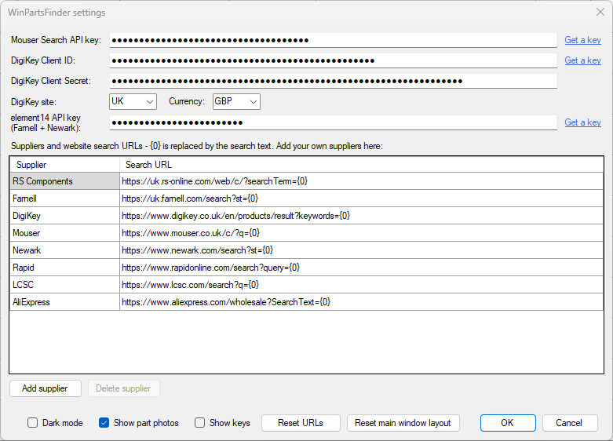

# WinPartsFinder

**Search the big electronic component suppliers at once — stock, prices, price breaks, MOQ, lifecycle status and datasheets side by side in one grid.**

Built for repairing test equipment and other electronics: type a part number or a few keywords, press Enter, and see who has it, how many, and at what price — without opening six browser tabs.

Windows 10 / 11 desktop app, written in VB.NET (Visual Studio 2022, .NET Framework 4.8).

<!-- Add a screenshot: save it as docs/WinPartsFinder_Main.png in the repo and this line will show it -->


---

## Suppliers

| Supplier | How it's searched | What you need |
|---|---|---|
| **Mouser** | Live API — stock, prices, lifecycle | Free Mouser **Search API** key |
| **DigiKey** | Live API — stock, prices, lifecycle | Free DigiKey **Client ID + Client Secret** |
| **Farnell** (UK) | Live API — stock, prices | Free **element14** API key |
| **CPC** (UK) | Live API — stock, prices | Same element14 key as Farnell |
| **Newark** (US) | Live API — stock, prices | Same element14 key as Farnell |
| **TME** (EU, ships to UK) | Live API — stock, prices (no datasheet links or RoHS filter) | Free TME **Token + Application secret** |
| **RS Components** | Website link | Nothing — no public search API |
| **Rapid** | Website link | Nothing — no public search API |
| **LCSC** | Website link | Nothing — no official public search API |
| **AliExpress** | Website link | Nothing — only an affiliate API |
| **Your own** | Website link | Add any supplier in Settings with its search URL |

A *website link* row opens that supplier's own search results in your browser with one click. Any API supplier without a key works as a website link too, so the app is useful straight away.

## Features

- **One search, every supplier** — results arrive as each supplier answers.
- **Advanced search** (Ctrl+F) — exact part number, look up a supplier order code across every supplier, in stock / RoHS / active only, manufacturer name, **part of a part number** (only remember "931G" and that it's a switch? it'll find KSC931G), description words (with or without a search term), quantity pricing and max price.
- **Types filtering** — after a search, click **Types…** to see every kind of part found (e.g. *Analogue to Digital Converter*, *Evaluation Kit*, *Flip-Flops*) with how many came from each supplier. Untick the ones you don't need and they disappear from the results instantly.
- **Prices in one currency** — tick *Prices in GBP* (or NZD, EUR, USD…) to see every supplier's price converted at the European Central Bank's daily rates, so you can compare and sort properly. Converted prices are shown in purple; hover for the supplier's own price.
- **Recent searches** — click the arrow on the Search box to pick from your last 30 searches; matching ones are also suggested as you type.
- **Load more** — fetch the next batch from suppliers that have more (e.g. *50 / 312*).
- **Part photos** — thumbnails, click for a bigger view.
- **Type** and **Datasheet** columns — the kind of part in each supplier's own words, and a one-click link to the datasheet when the supplier provides one.
- **Click the supplier part number** to open the product page; right-click to copy part numbers.
- **Sort, filter and tidy** — sort by any column, *In stock only*, a live text filter, remove rows you don't want, untick a supplier to hide its results (tick one after a search and it's searched straight away).
- **Row numbers** (#) that stay put, so you can note a part and find it again.
- **Export to CSV** for Excel.
- **Four colour themes** (Light, Soft grey, Dark grey and Dark), remembered window and column layout, tooltips on everything, built-in Help — plus a separate **API Help** in Settings that stays open while you paste in your keys.

## Screenshots

| | |
|---|---|
|  |  |
| *Types… — untick the kinds of part you don't want* | *Advanced search (Ctrl+F)* |
|  | |
| *Settings — your own API keys, suppliers and search URLs* | |

## Download and run

1. Download `WinPartsFinder.msi` from the latest release on the **Releases** page.
2. Run it. It installs to `C:\Program Files (x86)\IanJ\WinPartsFinder\` with a Start menu and desktop shortcut.
   - Nothing else to install: it uses .NET Framework 4.8, which is built into Windows 10 and 11.
   - The installer isn't code-signed yet, so Windows SmartScreen may say *"Windows protected your PC"* — click **More info → Run anyway**.
3. Start **WinPartsFinder**, click **Settings…**, paste in your API keys (see below) and search.

To upgrade, just run the newer `.msi` — it replaces the old version and keeps your settings and keys. Uninstall from **Settings → Apps**.

## Getting your free API keys

Each user needs their own keys — they're free. The **Get a key** links in Settings open each sign-up page, and the **API Help** button in Settings has these same steps in a window you can keep open while you paste the keys in.

**Mouser**
1. Go to the [Mouser API Hub](https://www.mouser.co.uk/api-hub/) and sign up for the **Search API**.
2. Paste the key into *Mouser Search API key*.

**DigiKey**
1. Sign in at [developer.digikey.com](https://developer.digikey.com/) and create an **Organization**.
2. Add a **Production App**. Select **ProductInformation V4** (leave the others as *None*). The *OAuth Callback* can be `https://localhost` — it isn't used.
3. Open the app and copy its **Client ID** and **Client Secret** into Settings.
4. Choose your DigiKey **site** and **currency** (e.g. UK / GBP, or NZ / NZD) — 44 countries and 26 currencies are listed.

**element14 (Farnell, CPC + Newark)**
1. Register an application at [partner.element14.com](https://partner.element14.com/).
2. Tick *Issue a new key for Product Search API*. The **Basic** tier is plenty for one person.
3. Paste the key into *element14 API key* — it works for Farnell, CPC and Newark.
4. Choose your **Farnell store** — any of 40 element14 country stores (UK, Ireland, Europe, Australia, New Zealand, Singapore, India…), each with its own stock, prices and currency.

**TME** (two websites are involved)
1. At [developers.tme.eu](https://developers.tme.eu/en) sign up, enter an application name (e.g. *WinPartsFinder*) and click **Create application**. This gives you the **Application secret**.
2. In another tab, log in to your **shop** account at [www.tme.eu](https://www.tme.eu) (not the developers site) — create a free customer account if you don't have one. Click **User panel → Applications → Register new app** and copy the **temporary token** it shows.
3. Back on developers.tme.eu, paste it into **Temporary token**, choose Key purpose **To compare distributors offer**, click **Generate new private key**, then **Show private keys**.
4. Paste that **Token** and the **Application secret** into Settings, and choose the **country** and **currency** for TME's prices (GB / GBP to start with).

Free tiers allow roughly 1,000 calls a day per supplier; each search, and each *Load more*, is one call (a TME search uses a few). You don't need every key — any supplier without one still appears as a website link.

Outside the UK? DigiKey, Farnell and TME can all be set to your own country and currency in Settings. Mouser uses the country of the account your key was registered with; CPC is UK-only and Newark US-only.

## Your keys and privacy

- Keys are stored **encrypted for your Windows user only** (Windows DPAPI) in `%AppData%\WinPartsFinder\settings.json`. They are never stored in the program or its source code.
- The app talks only to the suppliers' own APIs and websites. No accounts, no tracking, no telemetry.

## Building from source

1. Clone the repo and open `WinPartsFinder.sln` in **Visual Studio 2022** (17.8 or later) with the *.NET desktop development* workload.
2. Press **F5**.

The version number lives in one place: `AppVersion` at the top of `WinPartsFinder/Forms/MainForm.vb`.

```
WinPartsFinder/
  Forms/           Main window, Advanced search, Types, Settings, Help / API Help, About, photo pop-up
  Suppliers/       Mouser, DigiKey, element14 (Farnell/CPC/Newark), TME, website-link suppliers
  Models/          PartResult, PriceBreak, AdvancedSearchOptions
  Infrastructure/  Settings, theming (Light / Soft grey / Dark grey / Dark), web/JSON helpers, photo cache
```

**Adding an API supplier:** create a class in `Suppliers/` that inherits `ApiSupplier`, implement `IsConfigured` and `SearchAsync` (fill in `Category` so the part shows up in Types…), then add it in `AppSettings` and `SupplierFactory.Create`.

## Licence and usage

WinPartsFinder™ © 2026 Ian Johnston. Released under the licence below.

WinPartsFinder is provided **free of charge for personal, non-commercial use only**.
The source code is publicly available and may be used, modified and redistributed **for non-commercial purposes only**.
Neither WinPartsFinder nor its source code, in whole or in part, may be used for commercial purposes — including use within businesses and organisations — without a separate commercial licence from the author. Please contact the author via [www.ianjohnston.com](https://www.ianjohnston.com) to discuss commercial licensing.

The WinPartsFinder name and icon belong to the author. Modified or derived versions must not be called WinPartsFinder, or use a name or icon likely to be confused with it, without the author's written permission.

Each user must obtain their own supplier API keys and follow each supplier's API terms of use.

## Disclaimer

WinPartsFinder and its source code are provided "as is", without warranty of any kind, express or implied. Use is entirely at your own risk.
Prices, stock levels and other part data come from third parties and may be out of date or wrong — **always check with the supplier before ordering.**
Supplier names and trademarks belong to their respective owners. WinPartsFinder is not affiliated with or endorsed by any supplier.

## Support WinPartsFinder

If you find it useful, please consider a donation — it helps fund more development and the faulty test equipment repaired on my YouTube channel.

[**Donate via PayPal**](https://www.paypal.com/donate/?business=ian%40ianj.net&no_recurring=0&item_name=Support+WinPartsFinder&currency_code=GBP)

## Author

**Ian Johnston**
- Website: [www.ianjohnston.com](https://www.ianjohnston.com)
- YouTube: [youtube.com/user/IanScottJohnston](https://www.youtube.com/user/IanScottJohnston)
- Twitter / X: [@IanSJohnston](https://www.twitter.com/IanSJohnston)
